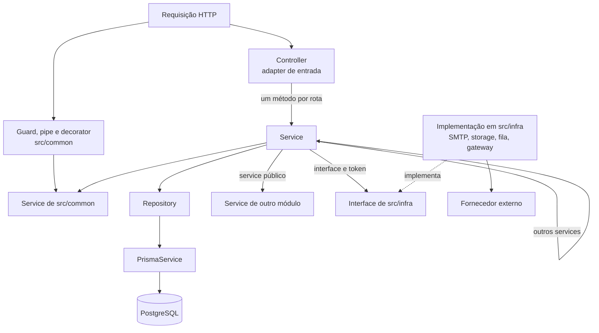
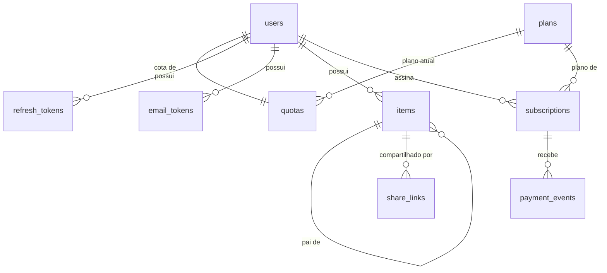
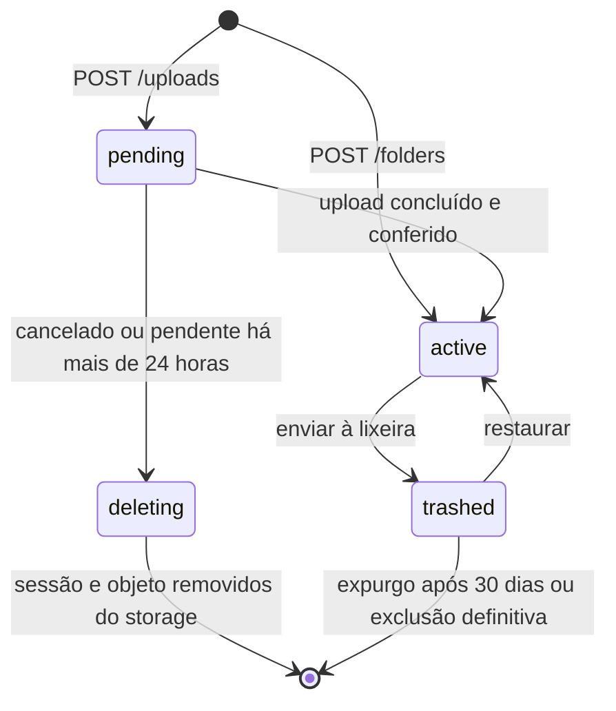
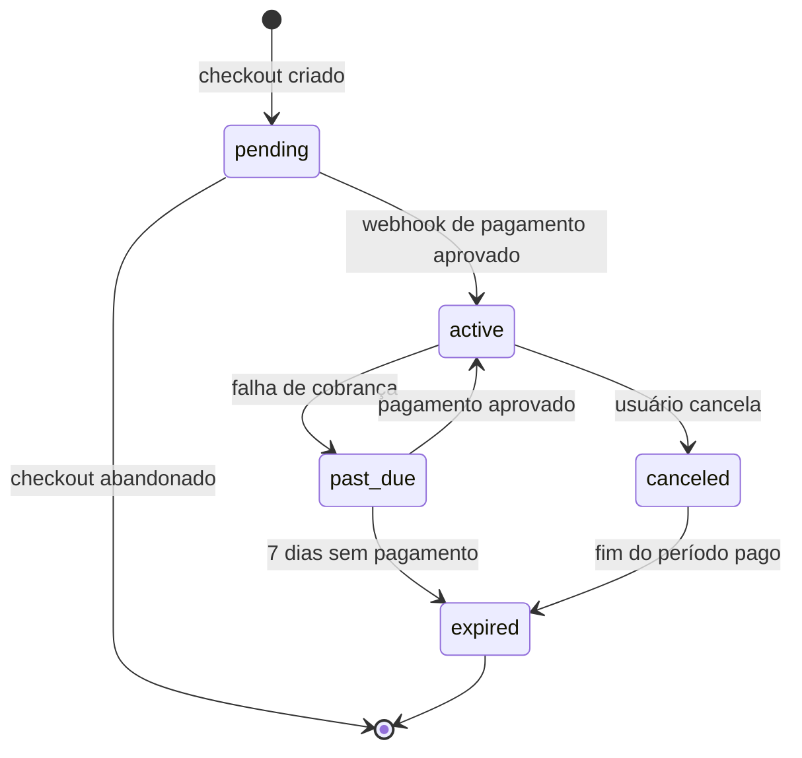

# LLD — Gerenciador de Arquivos (estilo Google Drive)

2026-10-08 · Luiz Carlos · Documentos de origem: [product-brief.md](./product-brief.md) e [hld.md](./hld.md)

Este documento detalha o MVP web no nível necessário para começar a codificar: estrutura do código, esquema do banco, contrato da API, estados e regras, tarefas do worker, configuração e o comportamento da web (rotas e telas, Sessão no navegador, envio e entrega de arquivos, erros). A arquitetura e os motivos das decisões estruturais estão no HLD.

## 1. Estrutura do código

O código fica num monorepo com pnpm workspaces, com dois projetos de deploy independente e um pacote de tipos compartilhados.

```text
/
├── apps/
│   ├── web/                  # Next.js (App Router)
│   │   ├── app/
│   │   │   ├── (auth)/       # login, cadastro, redefinição de senha
│   │   │   ├── (drive)/      # pastas, lixeira, busca, planos
│   │   │   └── s/[token]/    # página pública do link compartilhado
│   │   ├── components/
│   │   │   ├── ui/           # primitivos do design system (botões, campos, menu, diálogo)
│   │   │   └── <domínio>/    # navigation, files, sharing, plans, auth
│   │   ├── lib/api/          # cliente da API, usado só no servidor
│   │   ├── lib/session/      # leitura e renovação dos cookies de token
│   │   ├── lib/dal/          # camada de acesso a dados: confere a Sessão na API
│   │   ├── e2e/              # testes no navegador (Playwright)
│   │   └── proxy.ts          # renova os cookies e redireciona antes de cada rota
│   └── api/                  # NestJS (API e worker, mesma imagem)
│       ├── prisma/           # schema.prisma e migrações
│       ├── src/
│       │   ├── modules/
│       │   │   ├── users/    # dono da tabela users e de GET /me
│       │   │   ├── auth/     # Sessões, tokens de e-mail, cadastro e login
│       │   │   ├── items/
│       │   │   ├── uploads/
│       │   │   ├── sharing/
│       │   │   ├── quota/
│       │   │   ├── billing/
│       │   │   └── worker/   # endpoints internos das tarefas
│       │   ├── config/       # módulo de config: schema e leitura das variáveis de ambiente
│       │   ├── infra/        # database (cliente do Prisma), storage, tasks, mail, payment gateway
│       │   └── common/       # guards, filtros de erro, rate limit
│       └── test/             # suíte de ponta a ponta e a base de testes
└── packages/
    └── shared/               # tipos do contrato da API e códigos de erro
```

| Decisão | Escolha |
| --- | --- |
| ORM e migrações | Prisma 7, com o driver `pg`. As consultas recursivas de pastas usam SQL puro (`$queryRaw`). O Prisma 8 ainda é release candidate e troca a API do cliente, então a versão fica fixada na 7 até ele estabilizar. |
| Envio de e-mail | nodemailer, por SMTP, atrás da interface de `infra/mail` |
| Validação de entrada | class-validator nos DTOs da API e zod nos formulários da web |
| Configuração da API | `@nestjs/config`, com um schema do Joi que valida as variáveis de ambiente na subida |
| Textos da interface | Só em português, sem biblioteca de tradução |
| Documentação da API | OpenAPI gerado pelo NestJS (Swagger) |
| Autenticação | `@nestjs/jwt` com um guard próprio, sem Passport. Argon2 para o hash da senha. |
| Storage e fila | SDKs oficiais do Google Cloud (Storage e Cloud Tasks) |
| Testes | Vitest nas três suítes da API (unidade, integração e ponta a ponta) e na suíte de unidade da web, só para módulos puros, e Playwright nos testes no navegador da web |
| Lint e formatação | oxlint e Prettier na API, ESLint na web |

**Componentes da API:** os tipos de peça e como elas se comunicam estão na seção 1.1.

**Práticas de código da API:** a transação entre service e repository, o tratamento de erros, os nomes de arquivos, os níveis de teste e o módulo de config estão no `AGENTS.md` do projeto `api`, e não neste documento.

**Práticas de código da web:** a preferência por Server Components, as regras de cache, o acesso a dados e os formulários estão no `AGENTS.md` do projeto `web`, e não neste documento. O que a web faz (rotas e telas, Sessão, upload, entrega de arquivos, erros) está na seção 7.

**Chamadas do frontend:** o Next.js chama a API sempre no servidor (Server Components, Server Actions e Route Handlers). O navegador só fala direto com o Cloud Storage, para upload e download.

**IP do usuário:** como as chamadas saem do servidor do Next.js, a API enxergaria o IP da web. A web repassa o IP do navegador no cabeçalho `X-Client-Ip`, junto com o segredo `INTERNAL_API_SECRET` no cabeçalho `X-Internal-Secret`. A API só usa o IP repassado quando o segredo confere. Sem ele, ou com um IP repassado que não é um endereço válido, vale o IP da conexão. Um segredo que chega e não confere vai para o log da API, no máximo uma vez por minuto: é o sinal de que a web e a API estão com valores diferentes.

O IP que a web repassa é o último endereço do `X-Forwarded-For` da requisição do navegador, que é o que o Cloud Run acrescenta. Os endereços anteriores vêm do próprio navegador e não são confiáveis. Se um balanceador entrar na frente da web, o endereço certo deixa de ser o último, e esta regra muda junto.

**Pacote compartilhado:** o `packages/shared` e o workspace na raiz ainda não existem. Enquanto o contrato for pequeno, cada projeto mantém os próprios tipos. A migração para o workspace exige mudar os volumes e os Dockerfiles do Compose.

### 1.1 Componentes da API e como se comunicam

**Termo:** nesta documentação, **adapter** é só o adapter do lado que chama o sistema (o lado *driving*, ou de entrada): o que recebe uma chamada de fora e a traduz para o service. É o controller com os guards, os pipes e os decorators do HTTP, e os endpoints do worker. O service não conhece nenhum adapter: não importa controller, DTO, `Request` nem `Response`. As integrações que o service chama (e-mail, storage, fila e gateway) não são chamadas de adapter nem de port: são uma **interface de `src/infra/`** e a **implementação** dela.

Fora o adapter, o service chama qualquer outra peça. Cada peça é de um destes tipos, e o tipo decide quem ela pode chamar. As setas do diagrama são as únicas dependências permitidas: o que não tem seta não se injeta.



| Tipo | O que é | Pode injetar | Não pode injetar |
| --- | --- | --- | --- |
| **Adapter de entrada** (controller, e guard, pipe e decorator do HTTP) | Recebe a chamada de fora, valida a entrada e a traduz para o service | Services. O controller chama um método de service por rota, e o guard, services de `src/common/`. | Repository, `PrismaService` e a interface de `src/infra/` |
| **Service** | Regra de negócio: decide o que acontece e orquestra os outros | O repository e os outros services do próprio módulo, o service público de outro módulo, os services de `src/common/`, a interface de `src/infra/` pelo token, a configuração e, só para abrir uma transação, o `PrismaService` | Qualquer adapter de entrada, a implementação de uma interface de `src/infra/`, o repository ou as tabelas de outro módulo |
| **Repository** | Acesso ao banco e a atomicidade de cada comando | `PrismaService` | Service, outro repository e a interface de `src/infra/` |
| **Interface de `src/infra/`** | O contrato de uma integração externa, com o vocabulário da regra de negócio, e o token de injeção dela | Nada: só tipos | — |
| **Implementação de `src/infra/`** | A classe que implementa a interface e fala com o fornecedor | A configuração e o SDK do fornecedor | Service, repository e qualquer coisa de `src/modules/` |

- **O service é o ponto de composição.** É nele que as peças se encontram: o service chama outros services, o repository dele e as interfaces de `src/infra/`. O repository e a implementação de `src/infra/` são folhas e nunca chamam um service.
- **Service chama service,** do próprio módulo ou de outro, pela classe.
- **A direção é de fora para dentro.** O adapter de entrada chama o service, e o service nunca chama de volta. Um service que precisa do usuário autenticado, do IP ou de um cabeçalho os recebe como argumento tipado, extraídos pelo controller ou por um guard.
- **A implementação de `src/infra/` só aparece na ligação.** O módulo dela é o único que importa a classe, e exporta só o token da interface (`{ provide: MAIL_SENDER, useClass: SmtpMailSender }`). Quem precisa da integração importa o módulo e injeta o token, e o teste de um service troca a interface por um dublê.
- **Entre módulos, só o service público.** O módulo que oferece um service o exporta, e quem o usa importa o módulo. Repository, tabela e tipo interno de outro módulo não saem dele.
- **Sem ciclos.** Nem entre services nem entre módulos. Quando dois lados precisam um do outro, a parte comum vai para um terceiro lugar (um service próprio, ou `src/common/`). O `forwardRef` não é a solução.
- **Exemplo, o cadastro:** `AuthController` chama `RegistrationService`, que chama o `UsersService` (outro módulo), o `PasswordService`, o `EmailTokensService` (que usa o `EmailTokensRepository`), o `AuthAttemptsService` (que usa o `RateLimitService`, de `src/common/`) e o `AuthMailerService`. Este recebe o `MailSender`, a interface de `src/infra/mail/`, pelo token `MAIL_SENDER`, e o `MailModule` liga esse token ao `SmtpMailSender`, que nenhum service importa.

As integrações externas (storage, fila, e-mail e gateway de pagamento) ficam atrás de interfaces em `src/infra/`, para a troca de fornecedor ficar restrita a um arquivo. Guards, filtros de erro e rate limit ficam em `src/common/`. Cada módulo é dono das próprias tabelas.

## 2. Esquema do banco

**Convenções:** nomes em inglês e `snake_case`, chaves primárias em UUID v7 gerado pela aplicação, tamanhos em `BIGINT` (bytes), datas em `TIMESTAMPTZ` (UTC) e valores monetários em centavos.

**Extensões:** a primeira migração habilita `citext` (texto insensível a maiúsculas, usado no e-mail) e `pg_trgm` (trigramas, usados na busca). Ela não cria nenhuma tabela: cada tabela nasce na migração da funcionalidade dona dela.



**Tabelas implementadas:** `users`, `refresh_tokens`, `email_tokens`, `rate_limits`, `items`, `quotas` e `plans` são descritas pelo `apps/api/prisma/schema.prisma`, que é o dono delas: colunas, tipos e observações. Uma verificação confere que o schema tem a migração correspondente. Quando um ticket implementa uma tabela, ela sai desta seção e passa a morar no schema.

**Formato de uma tabela no schema:** toda tabela planejada ou alterada traz os itens do formato de tabela da skill de plano (`.claude/skills/plan-ticket/formatos/contrato.md`, "Tabela"). Neste projeto, o dono é o `schema.prisma`, e cada item se escreve assim:

| Item do formato | No `schema.prisma` |
| --- | --- |
| Colunas | O tipo do Prisma com o nativo (`@db.Uuid`, `@db.Timestamptz`), o `?` da coluna que aceita nulo, o `@default`, o `@map` para o nome em `snake_case` e a observação num comentário `///` |
| Chaves | `@id`, `@unique` e `@relation`, com a regra de exclusão (`onDelete`) |
| Índices | `@@index` e `@@unique`, e os parciais com `where` (prévia `partialIndexes`) |
| Restrição que o Prisma não expressa | Uma nota `///` obrigatória, na coluna ou no modelo, dizendo que ela é escrita à mão na migração, como um `CHECK` |

### items

Dona: o módulo `items`, que é também dono da Pasta raiz. A tabela está implementada e mora no `schema.prisma`, com os índices de listagem, de pendentes (que cobre também os itens `deleting`) e da raiz única por usuário, que são parciais (prévia `partialIndexes` do Prisma). Ficam para as funcionalidades donas delas:

| Coluna | Tipo | Observação |
| --- | --- | --- |
| `thumbnail_key` | `TEXT` | Nulo se não houver miniatura. Entra com a pré-visualização. |
| `trashed_at` | `TIMESTAMPTZ` | Preenchido ao enviar para a lixeira. Entra com a lixeira. |

**Índices ainda não implementados**

- `(owner_id, status, trashed_at)`, para a lixeira e o expurgo. Entra com a lixeira.
- Trigramas (`pg_trgm`, GIN) em `name`, para a busca. Entra com a busca.

### share_links

| Coluna | Tipo | Observação |
| --- | --- | --- |
| `id` | `UUID` | Chave primária |
| `item_id` | `UUID` | Referência a `items`, com exclusão em cascata |
| `owner_id` | `UUID` | Referência a `users` |
| `token_hash` | `TEXT` | SHA-256 do token do link. Único. |
| `password_hash` | `TEXT` | Argon2id. Nulo se o link não tiver senha. |
| `expires_at` | `TIMESTAMPTZ` | Nulo se o link não expirar |
| `created_at` | `TIMESTAMPTZ` | |

Como só o hash é guardado, a URL do link é exibida uma única vez, na criação. Depois disso, a listagem mostra a data, a expiração e se há senha, mas não a URL.

### subscriptions

| Coluna | Tipo | Observação |
| --- | --- | --- |
| `id` | `UUID` | Chave primária |
| `user_id` | `UUID` | Referência a `users` |
| `plan_id` | `UUID` | Referência a `plans` |
| `status` | `TEXT` | `pending`, `active`, `past_due`, `canceled` ou `expired` |
| `billing_cycle` | `TEXT` | `monthly` ou `yearly` |
| `payment_method` | `TEXT` | `card` ou `pix` |
| `current_period_start`, `current_period_end` | `TIMESTAMPTZ` | |
| `past_due_since` | `TIMESTAMPTZ` | Início da tolerância de 7 dias |
| `gateway_subscription_id` | `TEXT` | Referência no gateway |
| `created_at`, `updated_at` | `TIMESTAMPTZ` | |

Índice único em `(user_id)` filtrado por `status IN ('active', 'past_due', 'canceled')`: cada usuário tem no máximo uma assinatura vigente.

### payment_events

| Coluna | Tipo | Observação |
| --- | --- | --- |
| `id` | `UUID` | Chave primária |
| `gateway_event_id` | `TEXT` | Único. Garante que webhooks reenviados sejam ignorados. |
| `subscription_id` | `UUID` | Nulo se o evento não puder ser associado |
| `type` | `TEXT` | Tipo do evento no gateway |
| `payload` | `JSONB` | Conteúdo recebido |
| `received_at`, `processed_at` | `TIMESTAMPTZ` | |

## 3. Contrato da API

**Dono do contrato:** para as rotas implementadas, a forma (campos, tipos, status e erros por rota) é o `apps/api/openapi.json`, gerado do código. Uma verificação confere que o código bate com ele e que a mudança não quebra o contrato da base. As tabelas abaixo guardam as convenções, o comportamento de cada rota e as rotas ainda não implementadas; se a forma de uma rota implementada divergir do snapshot, vale o snapshot. Quando um ticket implementa uma rota, o desenho dela vai para o snapshot, no commit de plano.

**Formato de uma rota no snapshot:** toda rota planejada ou alterada traz, no snapshot, os itens do formato de rota da skill de plano (`.claude/skills/plan-ticket/formatos/contrato.md`, "Rota") que ela usa. Neste projeto, cada item é assim:

| Item do formato | Neste projeto |
| --- | --- |
| Método e caminho | Com o prefixo `/v1` |
| Autenticação | Rota protegida (`bearer`) ou pública |
| Parâmetros de caminho e de consulta | Com os limites, como `limit` de 1 a 200 |
| Corpo da requisição | Os campos do DTO, lidos pelo plugin do `@nestjs/swagger` |
| Cabeçalhos de entrada | Os que a rota lê além do `Authorization`, como `Idempotency-Key` |
| Resposta de sucesso | O DTO de resposta, uma classe, no tipo de retorno ou no decorator da resposta |
| Cabeçalhos de resposta | Como `Retry-After` ou `Location` |
| Erros | Cada status com os `code` da tabela de 3.1 que a rota pode devolver, inclusive o `validation_error`, quando a rota valida entrada, e o `unauthenticated`, quando ela é protegida |

Neste projeto, o que fica fora do formato (as regras de negócio, as transições de estado e as validades, como os 5 minutos da URL de download) fica nas seções 3.2 a 4. Como declarar um cabeçalho para que ele entre no snapshot está no `apps/api/AGENTS.md`, seção "Contrato OpenAPI".

### 3.1 Convenções

| Convenção | Escolha |
| --- | --- |
| Prefixo e versão | `/v1` |
| Formato | JSON, com campos em `camelCase` |
| Autenticação | `Authorization: Bearer <token de acesso>` |
| Erros | RFC 9457 (`application/problem+json`), com um campo `code` estável |
| Paginação | Por cursor: `?limit=50&cursor=...`. O `limit` vai de 1 a 200, com padrão de 50, e um valor fora disso responde `validation_error`. O cursor é opaco: o cliente só o devolve como recebeu, e um cursor ilegível responde `validation_error`. A resposta traz `nextCursor`, nulo na última página. |
| Ordenação de listagens | Pastas primeiro, depois por nome, na ordenação de texto do banco, com o id como desempate entre nomes iguais. O cursor guarda o último tipo, nome e id da página, e a página seguinte começa depois dele. |
| Idempotência | Cabeçalho `Idempotency-Key` em `POST /billing/checkout`. O `POST /uploads` não tem: uma repetição deixa um item `pending` invisível, que a limpeza de pendentes remove (seção 5). |

**Códigos de erro**

| HTTP | `code` | Quando |
| --- | --- | --- |
| 400 | `validation_error` | Entrada inválida |
| 400 | `invalid_token` | Token de verificação ou de redefinição inexistente, expirado ou já usado |
| 400 | `invalid_move` | Mover uma pasta para dentro dela mesma ou de uma descendente |
| 400 | `max_depth_exceeded` | Mais de 50 níveis de pastas |
| 401 | `unauthenticated` | Token ausente, inválido ou expirado |
| 401 | `invalid_credentials` | E-mail ou senha incorretos |
| 403 | `email_not_verified` | Login antes da verificação do e-mail |
| 403 | `link_password_required` | Link com senha, sem token de acesso ao link |
| 404 | `not_found` | Item inexistente ou de outro dono |
| 409 | `upload_size_mismatch` | Tamanho real diferente do declarado |
| 409 | `upload_incomplete` | Conclusão pedida antes de o objeto chegar inteiro ao storage |
| 410 | `link_expired` | Link expirado ou revogado |
| 413 | `file_too_large` | Arquivo acima de 5 GB |
| 413 | `quota_exceeded` | Sem espaço no plano |
| 429 | `rate_limited` | Limite de requisições atingido |
| 500 | `internal_error` | Falha não prevista. A resposta não traz mensagem interna nem stack trace. |

**Corpo do erro**

Todo erro sai com `Content-Type: application/problem+json` e este corpo:

```json
{
  "type": "about:blank",
  "title": "Bad Request",
  "status": 400,
  "code": "validation_error",
  "detail": "A entrada é inválida.",
  "errors": [{ "field": "email", "messages": ["email must be an email"] }]
}
```

| Campo | Conteúdo |
| --- | --- |
| `type` | Sempre `about:blank`. Quem identifica o erro é o `code`. |
| `title` | O nome padrão do status HTTP |
| `status` | O mesmo status da resposta |
| `code` | O código estável da tabela acima. É o único campo que a web usa para decidir a mensagem. |
| `detail` | Texto de apoio para quem desenvolve. Só aparece nos erros de regra de negócio e de validação. |
| `errors` | Só em `validation_error` de um corpo que não passou na validação: um item por campo, com o caminho do campo (`address.city` nos aninhados) e as mensagens |

- **Rota inexistente:** responde 404 com `not_found`.
- **Corpo malformado:** um JSON que não pode ser lido responde 400 com `validation_error`, sem `errors`.
- **Campos desconhecidos:** os campos que a rota não declara são descartados, sem erro.
- **Outros erros do framework:** um status que não está na tabela (405, 415 etc.) usa como `code` o nome do status em `snake_case`, por exemplo `method_not_allowed`.
- **Erro 5xx lançado de propósito:** quando o código responde de propósito com 501, 502, 503 ou 504, o status é mantido e o `code` é o nome dele (`service_unavailable`). A resposta continua sem `detail`, e a falha vai para o log.
- **Erro de terceiros:** só o que o framework levanta escolhe o status. Um erro de uma biblioteca ou do SDK de um fornecedor é sempre `internal_error`, mesmo que ele traga um status próprio.
- **Falha depois de a resposta começar:** se o erro acontece com a resposta já em envio, não dá mais para mandar o corpo de erro. A API registra a falha e derruba a conexão, para o cliente perceber que a resposta veio incompleta.

### 3.2 Autenticação e conta

| Método e rota | Entrada | Saída |
| --- | --- | --- |
| `POST /auth/register` | `email`, `password` | 201, mesmo se o e-mail já existir. Envia um e-mail, que varia conforme o caso (seção 4.7). |
| `POST /auth/verify-email` | `token` | 204. Não abre Sessão. |
| `POST /auth/resend-verification` | `email` | 204, mesmo se o e-mail não existir ou já estiver verificado |
| `POST /auth/login` | `email`, `password` | `accessToken`, `refreshToken`, `expiresIn` |
| `POST /auth/refresh` | `refreshToken` | Novo par de tokens |
| `POST /auth/logout` | `refreshToken` | 204, mesmo com token inválido ou expirado. Encerra a Sessão do token. |
| `POST /auth/logout-all` | | 204. Encerra todas as Sessões do usuário. |
| `POST /auth/forgot-password` | `email` | 204, mesmo se o e-mail não existir |
| `POST /auth/reset-password` | `token`, `password` | 204. Encerra todas as Sessões e não abre uma nova. |
| `GET /me` | | `id`, `email`, `plan`, `usedBytes`, `quotaBytes`, `readOnly` |
| `PATCH /me/password` | `currentPassword`, `newPassword` | 204. Encerra as outras Sessões. |

`GET /me` pertence ao módulo `users`. Até a funcionalidade de cota existir, ele devolve só `id` e `email`. `POST /auth/logout-all` e `PATCH /me/password` dependem de uma tela de conta e não fazem parte da primeira entrega de autenticação.

### 3.3 Itens, lixeira e busca

| Método e rota | Entrada | Saída |
| --- | --- | --- |
| `GET /items/{id}` | | O item e a trilha de pastas até a raiz |
| `GET /items/{id}/children` | `limit`, `cursor`, `type` (opcional, `folder`) | Lista de itens ativos da pasta |
| `POST /folders` | `name`, `parentId` | 201, a pasta criada |
| `PATCH /items/{id}` | `name` e/ou `parentId` | O item atualizado. Hoje só o `name` está implementado, e é obrigatório: o `parentId` entra com o mover, que o torna opcional. Renomear a Pasta raiz responde `validation_error`, e o atalho `root` vale no caminho. |
| `DELETE /items/{id}` | | 204. Envia para a lixeira. |
| `GET /trash` | `limit`, `cursor` | Itens enviados diretamente à lixeira |
| `POST /items/{id}/restore` | | O item restaurado |
| `DELETE /trash/{id}` | | 202. Exclusão definitiva, em segundo plano. |
| `DELETE /trash` | | 202. Esvazia a lixeira, em segundo plano. |
| `GET /search` | `q` (mínimo de 2 caracteres), `limit`, `cursor` | Itens ativos cujo nome contém `q` |

O id `root` é aceito como atalho para a pasta raiz do usuário. Na primeira vez que ele é usado, a raiz nasce (seção 4.1).

- **`GET /items/{id}/children`:** aceita `root` ou qualquer pasta ativa do Usuário; outro valor (inexistente, de outro Usuário, arquivo, não-UUID, `pending` ou `deleting`) responde `not_found`. O parâmetro `type=folder` é opcional e filtra para só pastas, para o seletor de "Mover para…"; qualquer outro valor responde `validation_error`. A ordenação, o cursor e o limite não mudam. A data que a lista mostra é a de modificação (`updatedAt`). A forma da resposta está no snapshot da OpenAPI.
- **`GET /items/{id}`:** devolve o Item e a trilha do topo (a Pasta raiz, "Meus arquivos") até ele; o atalho `root` devolve a trilha só com a raiz. Item inexistente, de outro Usuário, de id inválido ou não ativo responde `not_found`.

### 3.4 Upload e download

| Método e rota | Entrada | Saída |
| --- | --- | --- |
| `POST /uploads` | `name`, `sizeBytes`, `mimeType`, `parentId` | 201: `itemId`, `uploadUrl`, `expiresAt` |
| `GET /uploads/{itemId}` | | `itemId`, `uploadUrl`, `expiresAt`, para retomar um upload `pending` |
| `POST /uploads/{itemId}/complete` | | O item, já `active` |
| `DELETE /uploads/{itemId}` | | 204. Cancela e devolve o espaço. |
| `GET /items/{id}/download-url` | | `url`, `expiresAt` |
| `GET /items/{id}/thumbnail-url` | | `url`, `expiresAt`, ou 404 se não houver miniatura |

- **Entrada do upload:** `name` de 1 a 255 caracteres, sem `/` nem caracteres de controle. `sizeBytes` de 0 a 5 GB: acima disso, `file_too_large`, antes de reservar a cota. `mimeType` vazio é gravado como `application/octet-stream`. `parentId` é uma pasta `active` do usuário, e aceita `root`.
- **Upload que não está `pending`:** `GET` e `DELETE` em `/uploads/{itemId}` respondem `not_found`.
- **Retomada:** `GET /uploads/{itemId}` devolve a mesma `uploadUrl` e o mesmo `expiresAt` da criação, sem criar sessão nova. Um item `pending` ainda sem sessão (a criação dela não terminou ou falhou), um item `deleting`, um `pending` cujo prazo (`expiresAt`) já passou e a limpeza ainda não removeu, um de outro usuário e um id inexistente ou que não é UUID respondem `not_found`, como no cancelamento.
- **Download:** a URL assinada leva o nome do item no `Content-Disposition` (`filename*=UTF-8''…`, com acentos e espaços codificados), e não a chave do objeto. `expiresAt` é de 5 minutos a partir do pedido, a validade da URL. Pasta, item `pending`, item de outro usuário e id inexistente (ou que não é UUID) respondem `not_found`. O `disposition` entra com a pré-visualização: até lá, a rota não o recebe e é sempre `attachment`. Quem assina é o `ItemsService`, pela interface de storage (seção 4.6).

### 3.5 Compartilhamento

| Método e rota | Entrada | Saída |
| --- | --- | --- |
| `POST /items/{id}/share-links` | `expiresAt` e `password`, opcionais | 201: o link e o `token`, exibido só nesta resposta |
| `GET /items/{id}/share-links` | | Links do item, sem o token |
| `DELETE /share-links/{id}` | | 204 |
| `POST /public/links/{token}/access` | `password`, se o link exigir | Dados do item raiz do link e um `linkAccessToken` de 15 minutos |
| `GET /public/links/{token}/children` | `itemId`, `limit`, `cursor` | Itens ativos abaixo do item do link |
| `GET /public/links/{token}/items/{id}/download-url` | | `url`, `expiresAt` |

As rotas `/public` não exigem conta. Quando o link tem senha, as chamadas seguintes carregam o `linkAccessToken` no cabeçalho `Authorization`.

### 3.6 Cobrança

| Método e rota | Entrada | Saída |
| --- | --- | --- |
| `GET /plans` | | Planos ativos, com espaço e preços |
| `POST /billing/checkout` | `planCode`, `billingCycle`, `paymentMethod` | `checkoutUrl` |
| `GET /billing/subscription` | | A assinatura vigente, ou `null` |
| `POST /billing/subscription/cancel` | | A assinatura, com status `canceled` |
| `POST /webhooks/payments` | Evento do gateway | 200. Valida a assinatura do gateway, sem JWT. |

## 4. Estados e regras

### 4.1 Item



- **`deleting`:** o upload que o expurgo já tomou e cujo storage ainda está sendo limpo (seção 4.6). Fica invisível como o `pending` e nunca é ativado.
- **Enviar uma pasta à lixeira** marca só a pasta. Os descendentes continuam `active`, mas ficam inacessíveis.
- **Consequência para busca e links públicos:** como os descendentes não são marcados, essas consultas precisam conferir se algum ancestral está na lixeira. A conferência é feita com uma consulta recursiva sobre a página de resultados (até 200 itens, até 50 níveis).
- **Restaurar** devolve o item à pasta de origem. Se ela não existir mais ou estiver na lixeira, o item volta para a raiz.
- **Expurgo de uma pasta** remove todos os descendentes, de baixo para cima.
- **Profundidade:** conta as pastas do caminho, sem a Pasta raiz: uma pasta direto em "Meus arquivos" está no nível 1, e o 50º é o último que pode existir. Criar uma pasta no 50º nível responde `max_depth_exceeded`.
- **Lock consultivo por Usuário:** a transação que grava mudando a árvore (criar pasta e, no ticket de mover, mover) toma `pg_advisory_xact_lock` sobre o id do dono antes de conferir e gravar, para duas verificações do mesmo Usuário nunca enxergarem a árvore antiga ao mesmo tempo. Só as gravações do mesmo Usuário esperam umas pelas outras, e o lock se solta no fim da transação.
- **Mover:** a API sobe pelos ancestrais do destino e rejeita o pedido se encontrar o próprio item (`invalid_move`). O limite de 50 níveis vale para a árvore inteira: a profundidade do destino mais a altura da subárvore movida (consulta recursiva para baixo, só de pastas) não pode passar de 50 (`max_depth_exceeded`).
- **Pasta raiz:** nasce sob demanda, na primeira vez que o usuário a usa (o atalho `root`), com `INSERT ... ON CONFLICT DO NOTHING` seguido da leitura. O índice único da raiz garante uma só, mesmo com chamadas simultâneas. Ela se chama "Meus arquivos", nunca aparece numa listagem e não pode ser renomeada, movida nem excluída.

### 4.2 Cota

A reserva é um único comando, sem bloqueio explícito:

```sql
UPDATE quotas q
SET used_bytes = q.used_bytes + $size
FROM plans p
WHERE q.user_id = $user_id
  AND p.id = q.plan_id
  AND q.used_bytes + $size <= p.storage_bytes;
```

Se nenhuma linha for afetada, a API responde `quota_exceeded`. A reserva e a criação do item `pending` ocorrem na mesma transação. Antes da reserva, na mesma transação, a linha da cota é criada no plano gratuito se ainda não existir (`INSERT ... ON CONFLICT DO NOTHING`). O `UPDATE` também grava `updated_at = now()`, porque o `@updatedAt` do Prisma só vale nas gravações pelo cliente. A devolução subtrai com `GREATEST(used_bytes - $size, 0)`, e só quem tirou o Item de `pending` devolve, para a conclusão repetida ou simultânea não devolver duas vezes: o expurgo, que o passa a `deleting` (`UPDATE ... WHERE status = 'pending'`, seção 4.6), e a divergência de tamanho e a compensação do início, que o apagam (`DELETE ... WHERE status = 'pending'`). O módulo `quota` é o dono dessas duas tabelas e expõe `reserve` e `release` aos outros módulos, que passam o cliente da transação deles. O erro `quota_exceeded` nasce nele.

| Evento | Efeito em `used_bytes` |
| --- | --- |
| Iniciar upload | Soma o tamanho declarado |
| Cancelar upload ou limpeza de pendente | Subtrai, quando o item passa a `deleting`, antes de o storage ser limpo |
| Tamanho real diferente do declarado | Subtrai, e o objeto é apagado |
| Enviar à lixeira ou restaurar | Nenhum |
| Expurgo ou exclusão definitiva | Subtrai, depois de o objeto ser apagado do storage |

Pastas e miniaturas não contam para a cota. Uma rotina diária recalcula `used_bytes` pela soma dos itens e registra as divergências.

**Conta somente leitura:** é um estado calculado (`quotas.used_bytes > plans.storage_bytes`), não gravado. Ele bloqueia apenas o upload. Baixar, excluir, criar pastas e restaurar da lixeira continuam funcionando.

### 4.3 Assinatura



- **Ativação:** só o webhook de pagamento aprovado muda o `plan_id` da cota (`quotas`), pelo service do módulo `quota`. O retorno do navegador após o checkout não altera nada, e a tela de retorno espera a confirmação (seção 7.7).
- **Cancelamento:** o plano continua até `current_period_end`, sem reembolso proporcional.
- **Expiração:** o `plan_id` da cota volta ao plano gratuito. Nenhum arquivo é apagado, e a conta fica somente leitura se estiver acima da cota.
- **Webhook:** a API grava o evento em `payment_events` antes de processar. Se `gateway_event_id` já existir, o evento é ignorado e a resposta é 200.

### 4.4 Permissão

- **Dono:** toda consulta filtra por `owner_id`. Não há acesso a item de outro usuário no MVP.
- **Item inexistente ou de outro dono:** a resposta é 404 nos dois casos.
- **Link público:** dá leitura ao item do link e aos descendentes ativos dele. A cada chamada, a API confere que o item pedido está abaixo do item do link.
- **Item na lixeira:** os links para ele, ou para algo abaixo dele, respondem `link_expired` até a restauração.

### 4.5 Tokens

- **Token de acesso:** JWT com `sub` (id do usuário) e `exp`, assinado com RS256 e validado só pela assinatura.
- **Token de renovação:** valor opaco de 256 bits, guardado só como hash. Cada renovação emite um novo par e marca o token antigo como trocado.
- **Sessão:** é o login de um usuário em um navegador. Todos os tokens de renovação emitidos a partir de um mesmo login carregam o mesmo `session_id`. Sair apaga todos os tokens da Sessão. Não há limite de Sessões simultâneas por usuário.
- **Reuso de um token já trocado:** todas as Sessões do usuário são encerradas, por indicar possível roubo, e a resposta é `unauthenticated`. Isso vale mesmo que o token trocado já tenha expirado. Para não derrubar requisições que renovam ao mesmo tempo, o token antigo continua aceito por 10 segundos depois da troca. A janela conta da primeira troca, não se estica com os usos seguintes e fecha no décimo segundo, inclusive. O reuso e o encerramento das Sessões valem juntos, na mesma transação.
- **Token de renovação inexistente ou expirado:** a renovação responde `unauthenticated`, sem encerrar nenhuma Sessão.
- **Renovações simultâneas:** dentro dos 10 segundos, cada chamada com o token antigo recebe um par novo e válido, na mesma Sessão. A cadeia bifurca, o último cookie gravado vence e os tokens que sobram expiram sozinhos.
- **Trocas e encerramentos em fila:** a renovação, o logout e o encerramento de todas as Sessões de um mesmo usuário rodam um por vez no banco. Assim, uma renovação que corre junto com o logout não deixa um token novo numa Sessão que acabou de ser apagada.
- **Lado da web:** os cookies dos tokens, a renovação no Proxy, a verificação da Sessão e a volta ao destino estão na seção 7.2.

### 4.6 Upload em chunks

O navegador envia cada arquivo em chunks sequenciais para a sessão de upload retomável do Cloud Storage. A API só participa no início e na conclusão, e o protocolo do navegador (chunks, retomada, erros) está na seção 7.4.

- **Início:** `POST /uploads` reserva a cota (seção 4.2), cria o item `pending` e a sessão retomável no Cloud Storage, e devolve `itemId` e `uploadUrl`.
- **Conclusão:** `POST /uploads/{itemId}/complete` confere o tamanho real do objeto. Se for diferente do declarado, responde `upload_size_mismatch`, apaga o objeto e devolve o espaço. Se o objeto ainda não chegou inteiro, responde `upload_incomplete`, e o item continua `pending` para o navegador retomar.
- **Conclusão repetida:** num item já `active`, a conclusão devolve o item, sem conferir nem reservar de novo. Assim a chamada pode ser repetida com segurança.
- **Arquivo vazio:** um arquivo de 0 bytes reserva 0 bytes e é enviado num único `PUT` vazio.
- **Retomada e cancelamento:** `GET /uploads/{itemId}` devolve a `uploadUrl` de um upload `pending`, e `DELETE /uploads/{itemId}` cancela e devolve o espaço.
- **Remoção do objeto:** no `upload_size_mismatch`, a API apaga o objeto na hora, pela interface de storage. Se a remoção falhar, o item continua `pending` e a limpeza de pendentes o remove depois (seção 5).
- **Ordem do expurgo:** o cancelamento (`DELETE /uploads/{itemId}`) e a limpeza de pendentes (seção 5) apagam o upload do mesmo jeito, em três passos, sem transação aberta nem trava durante as chamadas ao storage. (1) Uma transação curta toma o item, `UPDATE items SET status = 'deleting' WHERE id = $id AND status = 'pending'` (no cancelamento, também pelo dono), e devolve o espaço à cota só se a linha mudou: repetir ou paralelizar o expurgo não devolve duas vezes. (2) A sessão de upload e depois o objeto saem do storage, cada remoção tentada mesmo que a outra falhe, e a primeira falha sobe. (3) A linha `deleting` é apagada. Na ordem inversa (a linha apagada antes do storage), uma falha no meio deixaria objetos órfãos, gerando custo sem registro.
- **Conclusão simultânea ao expurgo:** a ativação (`UPDATE ... WHERE status = 'pending'`) não encontra um item `deleting`, e a conclusão responde `not_found` na hora, sem esperar o storage. Se a conclusão ativa antes, o expurgo não toma o item, e o cancelamento responde `not_found`, com o objeto intacto. Nunca fica um item ativo sem o objeto.
- **Falha do storage no expurgo:** o item fica `deleting`, com o espaço já devolvido, e não volta a `pending`. O cancelamento responde `internal_error`; um novo cancelamento do mesmo item pelo dono refaz os passos 2 e 3 e responde 204. A limpeza conta a falha, segue com os demais e, nas próximas execuções, pega também os itens `deleting` tomados há mais que a carência da seção 5 e refaz os passos 2 e 3. Ela conta como removido só o item cuja linha ela mesma apagou: o que outro expurgo terminou no meio não entra na contagem.

**Como o upload de um arquivo é executado**

- **Ordem do início:** (1) o destino é resolvido (`root` ou uma pasta `active` do usuário; qualquer outro valor, inclusive um texto que não é UUID, é `not_found`); (2) uma transação cria a linha da cota, reserva o tamanho e cria o item `pending`, com a chave do objeto (UUID aleatório) e sem a sessão; (3) fora da transação, a sessão é criada no storage; (4) o endereço dela é gravado no item. Chamar o storage dentro da transação a prenderia durante uma chamada de rede. Se o passo 3 falhar, uma transação de compensação apaga o item pendente e devolve o espaço, e o erro sobe (`internal_error`). Se a compensação também falhar, o item fica `pending` e a limpeza o remove.
- **Validade da sessão:** `expiresAt` é a criação do item mais 24 horas, o prazo em que a limpeza remove um pendente (seção 5). O Cloud Storage guarda a sessão por mais tempo, e esse prazo não é o que o cliente vê.
- **Tamanho:** 5 GB são 5 GiB (5 × 1024³ bytes), como os 15 GB do plano gratuito são 15 GiB. O limite é inclusivo.
- **Conclusão:** o item é lido pelo dono (outro usuário e id inexistente, ou que não é UUID, são `not_found`). Já `active`, é devolvido. `pending`, o tamanho vem do storage: ausente, o item é relido, e é `upload_incomplete` se ele continua `pending` e `not_found` se um expurgo o tomou no meio da conclusão; diferente do declarado é `upload_size_mismatch`, igual ativa o item. Um item `deleting` é `not_found`, como o inexistente. A ativação é um `UPDATE ... WHERE status = 'pending'`: se outra conclusão chegou antes, a perdedora relê o item e o devolve.
- **Divergência de tamanho com falha na remoção:** no `upload_size_mismatch`, o objeto é apagado primeiro e, depois, uma transação apaga o item e devolve o espaço. Se o objeto não puder ser apagado, o erro do storage sobe (`internal_error`) e nada muda: o item continua `pending`, com o espaço reservado, até a limpeza.

**Interface de storage**

A interface `FileStorage` (`src/infra/storage/`, token `FILE_STORAGE`) é a única peça que conhece o Cloud Storage. A implementação, `GcsFileStorage`, usa o SDK oficial `@google-cloud/storage`. Os módulos de negócio a recebem pelo token e a descrevem com o vocabulário do negócio:

| Operação | O que faz |
| --- | --- |
| `createUploadSession` | Recebe o nome do objeto, o tipo MIME e a origem do frontend (`WEB_ORIGIN`), cria a sessão de upload retomável e devolve o endereço dela. A origem vai na criação porque o Cloud Storage amarra a sessão ao CORS dessa origem. |
| `signReadUrl` | Recebe o nome do objeto, o nome do arquivo e a validade, obrigatória: a interface não tem prazo padrão, e quem chama decide (o download usa 5 minutos, seção 3.4). Devolve uma URL assinada (V4) de leitura, com o nome do arquivo no `response-content-disposition` (`attachment; filename*=UTF-8''…`), e o `expiresAt`, contado do instante da assinatura. |
| `getObjectSize` | Devolve o tamanho em bytes, ou `null` se o objeto não existe. O objeto só passa a existir quando o envio termina. |
| `deleteObject` | Apaga o objeto. Um objeto que não existe não é erro. |
| `cancelUploadSession` | Cancela uma sessão pelo endereço dela (`DELETE`, que o Cloud Storage responde com 499). Qualquer resposta `4xx` (a sessão já terminou, expirou, foi finalizada ou é inválida) diz que ela não aceita mais bytes e não é erro; só o `5xx` e a falha de rede são. |

Uma falha do fornecedor (rede, permissão, bucket inexistente) sai como `StorageUnavailableError`, erro de domínio: o service não conhece o erro do SDK.

**Endereço público e assinatura local**

- **Dois endereços do emulador:** a API fala com ele por `STORAGE_EMULATOR_HOST` (`http://storage:4443`, o nome do serviço do Compose). O navegador não alcança esse host, e alcança `http://localhost:4443`, a porta que o Compose publica. Esse é o `STORAGE_PUBLIC_URL`, que só existe no ambiente local.
- **Endereço da sessão:** o emulador monta o endereço da sessão com o `Host` da requisição que recebeu, então ele volta com `storage:4443`. Com `STORAGE_PUBLIC_URL` definido, a implementação troca a origem do endereço por ela antes de devolvê-lo. Sem a variável (staging e produção), o endereço sai como veio do Cloud Storage.
- **URL assinada:** a implementação passa a origem de `STORAGE_PUBLIC_URL` como `host` da assinatura, e a URL já sai com o endereço que o navegador alcança. O emulador só serve a URL assinada (`/<bucket>/<objeto>`) quando o `Host` da requisição é igual ao `-public-host` dele, que o Compose define com o mesmo host e porta do `STORAGE_PUBLIC_URL`.
- **Navegador dos testes:** o navegador do serviço `playwright` está noutro contêiner, onde `localhost` não é o storage. A configuração do Playwright o faz resolver `localhost` para o serviço `storage` (`--host-resolver-rules`), e as páginas continuam na web (`http://web:3000`, ou o build servido pelo `scripts/verify.sh`).
- **Assinatura sem segredo real:** o SDK precisa de uma chave privada para assinar, mesmo apontado para o emulador. Em produção, a assinatura usa a identidade do serviço no Cloud Run, sem chave no ambiente. Localmente, o `scripts/setup-env.mjs` gera, na primeira subida, um par RSA descartável e grava a chave privada e um e-mail fictício no `.env`, como faz com o par do JWT, e não os versiona. O emulador não confere a assinatura nem a validade da URL: uma URL adulterada ou vencida também é servida.
- **Origem do SDK:** o SDK também lê `STORAGE_EMULATOR_HOST` do ambiente e, com ela definida, usa o valor como endereço-base sem o `/storage/v1`, o que dá 404 em toda chamada contra o emulador (verificado na versão 8.4.0). A implementação passa o endereço por configuração (`apiEndpoint`) e cria o SDK com a variável fora do ambiente, que volta em seguida.
- **Os testes no navegador não têm rota de apoio:** eles falam com o storage pelas rotas do produto. Criam a sessão por `POST /uploads`, conferem o tamanho pela conclusão e pedem a URL de leitura a `GET /items/{id}/download-url`.

**Resultado da validação contra o emulador (`fake-gcs-server` 1.56.1)**

- **Origem na criação da sessão:** a origem do frontend entra na criação da sessão (`origin`) e vale para a sessão inteira. O emulador a aceita, mas não a usa: o CORS dele é fixo.
- **CORS do bucket:** não é configurável no emulador. Ele aceita qualquer origem e expõe só o cabeçalho `Location`, então o `Range` da resposta 308 fica ilegível para o navegador. A leitura do `Range` é coberta no staging.
- **O que o emulador reproduz:** a sessão retomável com chunks (308 até o último, 200 no fim, objeto criado só então), o envio de um arquivo vazio num único `PUT`, a leitura por URL assinada com o nome do arquivo no download (`response-content-disposition` respeitado) e a remoção idempotente.
- **O que o emulador não reproduz:** o endereço da sessão sai com o host da requisição, e não com o `-external-url`; a consulta de progresso (`Content-Range: bytes */<total>`, sem corpo) é tratada como o fim do envio; o cancelamento da sessão só responde 499 e a sessão continua aceitando bytes; a URL assinada é servida sem conferir assinatura nem validade; o tamanho do chunk não precisa ser múltiplo de 256 KiB. Esses pontos são cobertos no staging (HLD, seção 6.1).

**Como os testes no navegador cobrem as duas lacunas do `Range` e da consulta de progresso:** um auxiliar de `e2e/support/` (`interceptStorageSession`) intercepta, pelo `page.route`, só os pedidos à sessão de upload. Ele repassa os chunks ao emulador e acrescenta à resposta o `Access-Control-Expose-Headers: Range`, que é o que o CORS do bucket faz no Cloud Storage, e responde ele mesmo à consulta de progresso, com 308 e o `Range` dos bytes que o emulador já confirmou. O mesmo auxiliar falha um chunk de propósito e segura outro enquanto a pessoa pausa ou cancela. A sessão, os chunks, a conclusão, a Cota e o objeto continuam sendo o emulador e a API reais. O comportamento do próprio Cloud Storage nesses dois pontos fica para o staging.

### 4.7 Cadastro, verificação e senha

**Cadastro**

O cadastro nunca revela se um e-mail já tem usuário. A resposta é sempre 201, e o que muda é o e-mail enviado.

| Situação do e-mail | Efeito | E-mail enviado |
| --- | --- | --- |
| Novo | Cria o usuário, não verificado | Verificação |
| Já cadastrado, não verificado | Substitui a senha e a data do aceite dos termos pelas novas e invalida os links anteriores | Verificação |
| Já cadastrado e verificado | Nenhum | "Você já tem conta", com os caminhos para entrar e redefinir a senha |

- **O último cadastro vence:** sem isso, quem cadastrasse primeiro o e-mail de outra pessoa ficaria com a senha de um usuário que ela mesma verificaria depois.
- **Risco residual aceito:** se um estranho se cadastrar depois do dono e o dono clicar no link do estranho, o usuário fica verificado com a senha do estranho. O usuário ainda está vazio, o dono não consegue entrar e usa "esqueci a senha", que troca a senha e encerra todas as Sessões.
- **Aceite dos termos:** o cadastro grava `terms_accepted_at`. A frase de aceite e os links ficam na tela de cadastro, descritos na seção 7.3.

**Verificação de e-mail**

- Usuário não verificado não entra: o login responde `email_not_verified`. Não há Sessão limitada.
- Verificar não abre Sessão. O usuário é levado ao login, com um aviso de sucesso.
- O reenvio emite um novo token e invalida o anterior.
- Se a verificação falha depois de o token ser gasto, a API devolve o token, e o mesmo link volta a valer.
- O link do e-mail aponta para a web, e as telas de verificação estão na seção 7.3.

**Redefinição de senha**

- O pedido responde 204 exista ou não o usuário, e só envia o e-mail no primeiro caso. Pedir outro link invalida o anterior.
- A API responde ao pedido logo depois de buscar o usuário, que custa o mesmo nos dois casos. A gravação do token e o envio do e-mail seguem sem espera, para o tempo de resposta não revelar se o e-mail tem usuário. Uma falha na gravação só é registrada em log, como a de envio.
- Funciona também para usuário não verificado.
- Concluir a redefinição marca o e-mail como verificado, porque a pessoa provou que controla a caixa.
- Encerra todas as Sessões, não abre uma nova e envia o e-mail "sua senha foi alterada". As Sessões são encerradas antes de a senha mudar: se a troca falha, a pessoa só precisa entrar de novo, e nunca fica com a senha nova e as Sessões antigas abertas. O token de acesso já emitido continua valendo até expirar, porque a API o valida só pela assinatura.
- Uma senha nova fora da regra é recusada antes de o token ser gasto, e o mesmo link continua valendo.
- Se a redefinição falha depois de o token ser gasto, a API devolve o token, como na verificação de e-mail.
- O link do e-mail aponta para a tela de nova senha da web, descrita na seção 7.3.

**Limite de tentativas**

- Vale para o login, o cadastro, o reenvio de verificação e o "esqueci a senha", com os tetos e as janelas da seção 6. Cada rota tem os próprios contadores, um por e-mail e um por IP: o cadastro, o reenvio e o "esqueci a senha" dividem os tetos, e não o contador.
- A chave "por conta" é o hash do e-mail digitado, exista ou não o usuário. Assim o bloqueio não revela quem tem cadastro. As maiúsculas e os espaços das pontas não contam, para o mesmo endereço não ganhar um contador por grafia.
- Toda tentativa conta, inclusive o login com a senha certa. A contagem vem antes de qualquer consulta ao usuário, e a resposta bloqueada é a mesma exista ele ou não. Uma entrada que a validação recusa não é contada.
- A tentativa é contada nas duas chaves mesmo quando uma delas já estourou.
- O IP é o do navegador, repassado pela web (seção 1). As grafias do mesmo endereço contam juntas: um IPv6 abreviado ou por extenso, e o IPv4 embrulhado em IPv6.
- Estourado o limite, a resposta é `rate_limited` até a janela fechar, mesmo com a senha certa. Um terceiro consegue travar o login de alguém por 15 minutos; o MVP aceita esse risco.

**Envio de e-mail**

- A API envia por SMTP, atrás da interface de `infra/mail`, e responde sem esperar o envio terminar. Isso também evita que o tempo de resposta revele se o e-mail existe.
- Uma falha de envio só é registrada em log. O usuário usa o reenvio.
- Os e-mails são de texto simples com a marca, sem desenho no Figma.

## 5. Tarefas do worker

O worker é a mesma imagem da API, publicada como um serviço separado do Cloud Run. Ele expõe endpoints HTTP internos, que só aceitam chamadas autenticadas (OIDC) do Cloud Tasks e do Cloud Scheduler. Todas as tarefas são idempotentes.

| Tarefa | Disparo | Em caso de falha |
| --- | --- | --- |
| Gerar miniatura de imagem | Cloud Tasks, na conclusão do upload | 3 tentativas. Depois disso, o arquivo fica sem miniatura. |
| Limpar uploads `pending` há mais de 24 horas e os `deleting` tomados há mais de 15 minutos | Cloud Scheduler, a cada hora | O item fica `deleting`, e a próxima execução termina a remoção |
| Expurgar itens há mais de 30 dias na lixeira | Cloud Scheduler, diário | Tenta de novo na próxima execução |
| Apagar objetos no Cloud Storage | Cloud Tasks, uma tarefa por lote | Novas tentativas com espera crescente |
| Gerar cobrança Pix | Cloud Scheduler, diário, 5 dias antes do vencimento | Nova tentativa e alerta |
| Expirar assinaturas `past_due` há mais de 7 dias e `canceled` com período encerrado | Cloud Scheduler, diário | Tenta de novo na próxima execução |
| Reconciliar `used_bytes` | Cloud Scheduler, diário | Só registra a divergência |
| Limpar tokens, links e contadores expirados | Cloud Scheduler, diário | Tenta de novo na próxima execução |

**Antes do worker:** enquanto o serviço do worker não existe, a limpeza de uploads `pending` roda por um comando no contêiner `api`, que chama o mesmo service que o endpoint do worker vai chamar. É o substituto local do Cloud Scheduler (HLD, seção 6.1), e o uso dele está em `apps/api/AGENTS.md`. A ordem de cada remoção é a do expurgo, abaixo. O worker, o endpoint interno com OIDC e a fila entram quando houver deploy, e a miniatura entra com a pré-visualização.

**Ordem do expurgo:** é a mesma do cancelamento, na seção 4.6 ("Ordem do expurgo" e "Falha do storage no expurgo"). A miniatura, quando existir, sai do Cloud Storage junto com o objeto. O `pending` listado ainda é tomado, e fica de fora se uma conclusão ou outro expurgo chegou antes; o `deleting` listado já foi tomado e vai direto aos passos 2 e 3.

**Carência dos `deleting`:** a limpeza só pega um item `deleting` 15 minutos depois da tomada, que é o `updated_at` que a tomada grava (nenhuma outra gravação muda um item `deleting`). Antes disso, o expurgo que o tomou (um cancelamento ou outra limpeza) pode ainda estar limpando o storage, e as duas fariam o mesmo trabalho ao mesmo tempo. O prazo fica bem acima do que um expurgo leva (o cancelamento da sessão tem 10 segundos de limite) e abaixo do intervalo da limpeza, então um item que ficou para trás é terminado na execução seguinte. O cancelamento pelo dono não espera a carência.

**Miniaturas:** são geradas só para imagens de até 50 MB, com 320 px no lado maior, em WebP, e gravadas no mesmo bucket sob o prefixo `thumbnails/`.

## 6. Configuração e segurança

**Limites e prazos**

| Item | Valor |
| --- | --- |
| Token de acesso | 15 minutos |
| Token de renovação | 30 dias, com rotação a cada uso |
| Tolerância ao reuso de um token de renovação trocado | 10 segundos |
| Token de acesso a link com senha | 15 minutos |
| Senha | De 10 a 128 caracteres, sem regra de composição, com hash Argon2id |
| Tentativas de login | 5 por e-mail e 20 por IP a cada 15 minutos |
| Cadastro, reenvio de verificação e "esqueci a senha" | 3 por e-mail e 10 por IP a cada hora |
| Tentativas de senha de link público | 10 por link a cada 15 minutos |
| Limite geral da API | 300 requisições por minuto por usuário |
| Tamanho máximo por arquivo | 5 GB |
| URL assinada de download | 5 minutos |
| Sessão de upload retomável | 24 horas |
| Retenção da lixeira | 30 dias |
| Tolerância de pagamento | 7 dias |
| Profundidade de pastas | 50 níveis |

A retenção da lixeira, o prazo de upload pendente, a validade dos tokens, a tolerância ao reuso e os tetos e as janelas das tentativas de login e dos pedidos de e-mail são lidos de variáveis de ambiente. Os valores da tabela são os padrões de produção, e o ambiente local pode reduzi-los para testar.

**CORS**

- **API:** só a origem do frontend.
- **Bucket:** só a origem do frontend, para os métodos de upload e download.

**Variáveis de ambiente**

| Variável | Projeto | Conteúdo |
| --- | --- | --- |
| `PORT` | api | Porta HTTP, com padrão 3000. O Cloud Run a define em produção. |
| `DATABASE_URL` | api | Conexão com o Cloud SQL (segredo). No desenvolvimento, aponta para o `postgres`. |
| `JWT_PRIVATE_KEY`, `JWT_PUBLIC_KEY` | api | Par de chaves RSA do RS256, em PEM (segredo). São aceitos os formatos PKCS#8, SPKI e PKCS#1. |
| `GCS_BUCKET` | api | Nome do bucket privado |
| `TASKS_QUEUE`, `WORKER_URL` | api | Fila do Cloud Tasks e endereço do worker |
| `QUEUE_DRIVER` | api | `cloud-tasks` em staging e produção, `local` no desenvolvimento (chamada HTTP direta ao worker) |
| `STORAGE_EMULATOR_HOST` | api | Endereço do emulador de storage, só no desenvolvimento (`http://storage:4443`) |
| `STORAGE_PUBLIC_URL` | api | Origem do emulador que o navegador alcança, só no desenvolvimento (`http://localhost:4443`). Obrigatória quando `STORAGE_EMULATOR_HOST` existe. |
| `STORAGE_SIGNER_EMAIL`, `STORAGE_SIGNER_PRIVATE_KEY` | api | Credencial de assinatura das URLs, só no desenvolvimento: um e-mail fictício e uma chave RSA em PEM gerada pelo `setup-env.mjs`. Obrigatórias quando `STORAGE_EMULATOR_HOST` existe, e ausentes em produção, onde a assinatura usa a identidade do serviço. |
| `TRASH_RETENTION_DAYS`, `PENDING_UPLOAD_TTL_HOURS` | api | Padrões de 30 dias e 24 horas. O prazo dos pendentes é um inteiro maior ou igual a 0, e zero faz todo pendente vencer na hora. |
| `ACCESS_TOKEN_TTL_SECONDS`, `REFRESH_TOKEN_TTL_SECONDS` | api | Validade do token de acesso e do token de renovação, em segundos. Padrões de 900 (15 minutos) e 2592000 (30 dias). |
| `REFRESH_TOKEN_REUSE_GRACE_SECONDS` | api | Por quanto tempo um token de renovação já trocado ainda é aceito, em segundos. Padrão de 10. Zero desliga a tolerância. |
| `EMAIL_VERIFICATION_TTL_SECONDS` | api | Validade do link de verificação de e-mail, em segundos. Padrão de 86400 (24 horas). |
| `PASSWORD_RESET_TTL_SECONDS` | api | Validade do link de redefinição de senha, em segundos. Padrão de 3600 (1 hora). |
| `PAYMENT_API_KEY`, `PAYMENT_WEBHOOK_SECRET` | api | Credenciais do gateway (segredo) |
| `SMTP_URL`, `MAIL_FROM` | api | Servidor SMTP do serviço de e-mail (segredo) e remetente. No desenvolvimento, aponta para o `mailpit`. |
| `DATABASE_CONNECT_TIMEOUT_MS` | api | Quanto esperar o banco para abrir uma conexão, em milissegundos. Padrão de 10000. |
| `SMTP_TIMEOUT_MS` | api | Quanto esperar o servidor SMTP para resolver o nome, conectar e saudar, em milissegundos. Padrão de 10000. |
| `SMTP_IDLE_TIMEOUT_MS` | api | Quanto uma conexão SMTP aberta pode ficar sem tráfego, durante um envio ou entre um envio e outro, em milissegundos. Padrão de 60000. |
| `WEB_ORIGIN` | api | Origem do frontend, para CORS e links de e-mail: esquema, host e porta, sem caminho nem barra no fim. No desenvolvimento, é o endereço que a pessoa abre no navegador (`http://localhost:3000`). |
| `INTERNAL_API_SECRET` | api e web | Segredo que autoriza a web a repassar o IP do usuário (segredo). Tem pelo menos 32 caracteres, e o valor é o mesmo nos dois projetos. |
| `LOGIN_RATE_LIMIT_PER_EMAIL`, `LOGIN_RATE_LIMIT_PER_IP`, `LOGIN_RATE_LIMIT_WINDOW_SECONDS` | api | Tentativas de login por e-mail e por IP, e a janela, em segundos. Padrões de 5, 20 e 900 (15 minutos). |
| `EMAIL_REQUEST_RATE_LIMIT_PER_EMAIL`, `EMAIL_REQUEST_RATE_LIMIT_PER_IP`, `EMAIL_REQUEST_RATE_LIMIT_WINDOW_SECONDS` | api | Cadastros, reenvios de verificação e pedidos de "esqueci a senha" por e-mail e por IP, e a janela, em segundos. Padrões de 3, 10 e 3600 (1 hora). |
| `API_URL` | web | Endereço interno da API |
| `COOKIE_DOMAIN` | web | Domínio dos cookies de token |
| `COOKIE_SECURE` | web | Padrão `true`. `false` só no desenvolvimento, que usa HTTP. |

**Validação na subida:** a API valida as próprias variáveis ao iniciar e não sobe se alguma obrigatória faltar ou vier inválida. Hoje o schema cobre `PORT`, `DATABASE_URL`, `JWT_PRIVATE_KEY`, `JWT_PUBLIC_KEY`, `SMTP_URL`, `MAIL_FROM`, `SMTP_TIMEOUT_MS`, `SMTP_IDLE_TIMEOUT_MS`, `DATABASE_CONNECT_TIMEOUT_MS`, `WEB_ORIGIN`, `EMAIL_VERIFICATION_TTL_SECONDS`, `PASSWORD_RESET_TTL_SECONDS`, `ACCESS_TOKEN_TTL_SECONDS`, `REFRESH_TOKEN_TTL_SECONDS`, `REFRESH_TOKEN_REUSE_GRACE_SECONDS`, `INTERNAL_API_SECRET` e as seis variáveis do limite de tentativas, e todas, menos `PORT`, os quatro prazos, as quatro validades, a janela de tolerância e as seis do limite de tentativas, são obrigatórias. As chaves do JWT são lidas de verdade na validação: uma chave que não é RSA, que não pode ser lida, ou uma pública que não é o par da privada, impede a subida. O `MAIL_FROM` tem de trazer um endereço de e-mail, sozinho ou como `Nome <endereço>`. Cada uma das outras variáveis da tabela entra no schema e no `.env.example` junto com a funcionalidade que a usa.

**Ambiente local:** as variáveis da API ficam em `apps/api/.env`, fora do Git. Na primeira subida, o contêiner da API cria esse arquivo como cópia do `apps/api/.env.example`, que é versionado e funciona sem alterações, e um script gera as chaves do JWT e as grava nele. Quando o `.env.example` ganha uma variável, o mesmo script a acrescenta ao `.env` que já existe, sem trocar nenhum valor. Os hosts são sempre os nomes dos serviços do Compose. A `API_URL`, o `COOKIE_SECURE=false` e o `INTERNAL_API_SECRET` da web são definidos no próprio `compose.dev.yaml`, sem arquivo `.env`. O `.env.example` da API traz o mesmo segredo e sobe os tetos por IP, porque no ambiente local o navegador da pessoa e os testes no navegador saem todos do mesmo IP.

**Banco de testes:** os testes da API usam um banco separado no mesmo PostgreSQL, com o nome do banco de `DATABASE_URL` mais o sufixo `_test`. Ele não tem variável própria.

Os valores marcados como segredo vêm do Secret Manager e não ficam em arquivos versionados.


## 7. Web

Esta seção descreve o que a web apresenta e protege: as rotas e telas, a Sessão no navegador, o envio de arquivos, a entrega de arquivos ao navegador e a reação aos erros da API. O contrato que ela consome está nas seções 3 e 4, e as práticas de código dela (Server Components, `lib/dal`, formulários, cache e testes no navegador) estão no `AGENTS.md` do projeto `web`. A linguagem visual está no `docs/design-system.md`.

### 7.1 Mapa de rotas e telas

**Acesso:** "só sem Sessão" manda para o produto quem tem Sessão. "Pública" abre com ou sem Sessão. "Protegida" exige Sessão, e é o padrão de toda rota nova (seção 7.2). A coluna **Situação** diz se a tela existe ou se é um caminho proposto, a detalhar na spec dela.

| Rota | Acesso | Lê da API | Ações (Server Action ou rota) | Situação |
| --- | --- | --- | --- | --- |
| `/criar-conta` | Só sem Sessão | | `POST /auth/register` | Existe |
| `/confira-seu-email` | Só sem Sessão | | `POST /auth/resend-verification` | Existe |
| `/verificar-email` | Pública, rota que só redireciona | | `POST /auth/verify-email`, e leva ao login | Existe |
| `/verificar-email/link-invalido` | Pública | | Pede outro link de verificação | Existe |
| `/entrar` | Só sem Sessão | | `POST /auth/login` | Existe |
| `/esqueci-minha-senha` | Pública | | `POST /auth/forgot-password` | Existe |
| `/esqueci-minha-senha/enviado` | Pública | | | Existe |
| `/redefinir-senha` | Pública | | `POST /auth/reset-password` | Existe |
| `/redefinir-senha/link-invalido` | Pública | | Pede outro link de redefinição | Existe |
| `/sessao-encerrada` | Pública, rota que só redireciona | `POST /auth/refresh` | Renova a Sessão ou a encerra | Existe |
| `/termos`, `/privacidade` | Pública | | | Existe, provisórias |
| `/` | Protegida | `GET /me`, `GET /items/root`, `GET /items/root/children`, `POST /folders` | Sair (`POST /auth/logout`), pelo menu da conta, breadcrumb, abrir uma pasta por duplo clique, "Nova pasta" (Server Action), "Carregar mais" e "Enviar" (`POST /uploads` e `POST /uploads/{itemId}/complete`, por Server Action). "Baixar", no menu da linha de um arquivo, é um link para `/arquivos/[id]/baixar`. | Existe: "Meus arquivos", a lista da pasta raiz |
| `/pasta/[id]` | Protegida | `GET /items/{id}`, `GET /items/{id}/children`, `POST /folders` | Abrir uma pasta por duplo clique, breadcrumb, "Carregar mais", "Nova pasta" (Server Action) e "Enviar" para a pasta aberta. Id de arquivo, inexistente, de outro Usuário, não-UUID ou de Item não ativo mostra a página de não encontrado. Renomear, mover, excluir e compartilhar ficam para os tickets seguintes | Existe (renomear, mover e excluir a detalhar) |
| `/lixeira` | Protegida | `GET /trash` | Restaurar, excluir definitivamente, esvaziar | A detalhar |
| `/busca?q=` | Protegida | `GET /search` | | A detalhar |
| `/planos` | Protegida | `GET /plans`, `GET /billing/subscription` | `POST /billing/checkout`, `POST /billing/subscription/cancel` | A detalhar |
| `/planos/retorno` | Protegida | `GET /billing/subscription` | | A detalhar (seção 7.7) |
| `/arquivos/[id]/baixar` | Protegida, rota que só redireciona | `GET /items/{id}/download-url` | | Existe (seção 7.5) |
| `/arquivos/[id]/miniatura`, `/visualizar` | Protegida, rotas que só redirecionam | `GET /items/{id}/thumbnail-url`, `GET /items/{id}/download-url` | | A detalhar (seção 7.5) |
| `/s/[token]` | Pública | `POST /public/links/{token}/access`, `GET /public/links/{token}/children` | Informar a senha do link | A detalhar (seção 7.6) |
| `/s/[token]/baixar/[id]` | Pública, rota que só redireciona | `GET /public/links/{token}/items/{id}/download-url` | | A detalhar (seção 7.6) |

- **Casca do `(drive)` hoje:** a barra superior com a marca e o menu da conta (o e-mail e "Sair"), a navegação só com "Meus arquivos", aberta como gaveta pelo botão de menu abaixo de `lg`, o botão "Enviar", que escolhe arquivos e os envia num único `PUT` ao storage (o corte em chunks, a repetição, os vários arquivos e o arrastar e soltar entram com os arquivos grandes), o painel de envios, com o nome e o estado (enviando, concluído ou falhou, com o erro em português) de cada arquivo, num provider de cliente do layout, e a área de conteúdo, com o título da pasta. O que o item seguinte descreve e ainda não existe entra com a funcionalidade dona, sem link morto nem botão desabilitado.
- **Linha da lista hoje:** ícone do tipo, nome, tipo, tamanho e data de modificação, sem miniatura nem seleção. Toda linha tem o botão "Mais ações": o menu do arquivo tem "Baixar" e "Renomear", e o da pasta, só "Renomear" ("Mover para…" e "Excluir" entram com o mover e a lixeira). "Renomear" abre um diálogo com o nome atual todo selecionado, a extensão inclusive, e o erro de nome inválido aparece nele, sem fechá-lo. O duplo clique não faz nada até a pré-visualização existir. O tipo é "Pasta" ou um rótulo tirado do `mimeType`, com os rótulos do Figma. O tamanho e a data saem formatados em português, a data no fuso `America/Sao_Paulo`, porque o Server Component roda em UTC.
- **Layout do `(drive)`:** mostra a navegação (início, lixeira, busca, planos), o indicador de uso da cota (`usedBytes` e `quotaBytes` de `GET /me`) e o painel de envios (seção 7.4). Uma conta somente leitura (`readOnly`) tem o envio desligado, com o motivo e o caminho para `/planos`.
- **Estado na URL:** a pasta atual (`/pasta/[id]`), a busca (`q`) e o arquivo aberto na pré-visualização (`?ver=<id>`) ficam na URL.
- **Paginação das listas:** o Server Component mostra a primeira página, e um botão "Carregar mais", no fim da lista, busca a seguinte por Server Action e a acrescenta no cliente. O cursor não vai para a URL. Depois de um upload, o `router.refresh()` atualiza a primeira página, e as páginas acrescentadas ficam como estavam. Depois de renomear, o diálogo descarta as páginas acrescentadas e volta à primeira página do servidor, porque o `router.refresh()` não atualiza uma linha já acrescentada. O diálogo de compartilhar e o menu de cada item são estado de cliente.
- **Pré-visualização:** abre sobre a lista, a partir de `?ver=<id>`, e usa a rota `/arquivos/[id]/visualizar` como origem da imagem, do vídeo, do áudio, do PDF e do texto.
- **Estrutura de pastas:** a árvore da seção 1 mostra a organização do código. As rotas desta tabela entram nos grupos `(auth)`, `(drive)` e `s/[token]` dela.

### 7.2 Sessão, cookies e Proxy

A API (seção 4.5) emite e troca os tokens. A web os guarda e os renova.

- **Cookies no Next.js:** os dois tokens ficam em cookies `HttpOnly`, `Secure` e `SameSite=Lax`. O `Secure` é desligado por `COOKIE_SECURE=false` no ambiente local, que usa HTTP. O cookie do token de acesso dura o mesmo que o token, e o do token de renovação, 30 dias, a validade padrão dele.
- **Renovação no `proxy.ts`:** antes de cada rota, o Proxy lê o `exp` do token de acesso, sem conferir a assinatura. Se ele expirou, o Proxy chama `/auth/refresh` e regrava os cookies. O token conta como expirado 5 segundos antes do `exp`, para não vencer no caminho até a API. Os tokens novos seguem também na requisição, para a rota já renderizar com eles. O Proxy espera a renovação por 5 segundos, menos que a janela de tolerância: se a API troca o token e a resposta se perde, a tentativa seguinte ainda é aceita. Se a API recusa o token de renovação, ele apaga os cookies e redireciona para o login, com o aviso "Sua sessão expirou" (`/entrar?aviso=sessao-expirada`). Se a API falha, a Sessão não é encerrada: os cookies ficam, a pessoa vai para o login sem o aviso, e a rota seguinte tenta renovar de novo. O Proxy também manda para o login quem não tem Sessão e tira das telas `(auth)` quem tem.
- **Server Actions no Proxy:** uma Server Action não é redirecionada pelo Proxy, porque o navegador repetiria o envio na tela de entrar e mostraria um erro. Com ou sem Sessão, ela segue, e é a própria ação que confere a Sessão. É o que deixa o "Sair" funcionar com a Sessão já expirada.
- **Verificação na web:** a web não tem a chave pública nem valida o JWT. Toda página e Server Action protegida passa pela camada de acesso a dados (`lib/dal`), que confere a Sessão na API: pelo `GET /me` ou, numa leitura protegida, pela própria chamada da leitura, que a API recusa do mesmo jeito. Um `401` ali derruba a Sessão: como a renderização de uma página não pode apagar cookies, a camada leva à rota `/sessao-encerrada`, que confere a Sessão de novo na API e tenta renová-la. Se a renovação passa, a pessoa volta ao produto com o par novo. Se a API recusa o token de renovação, a rota apaga os cookies e leva ao login, com o mesmo aviso. O Proxy é só um filtro otimista, nunca a única barreira.
- **Volta ao destino:** quem é barrado numa rota protegida volta para ela depois de entrar. O Proxy leva a página pedida no parâmetro `destino` da tela de entrar. O destino só aceita caminhos internos, e qualquer outro valor leva à página inicial.
- **Rotas protegidas por padrão:** o Proxy tem a lista das telas de autenticação e a das rotas públicas. Toda rota fora das duas exige Sessão.

### 7.3 Telas de e-mail e senha

O que a API faz nesses fluxos está na seção 4.7. Este é o comportamento da web.

**Cadastro**

- **Aceite dos termos:** a tela mostra a frase de aceite com os links para `/termos` e `/privacidade`, sem checkbox.

**Verificação de e-mail**

- Depois do cadastro ou do pedido de outro link, a web guarda o e-mail num cookie `HttpOnly` de uma hora, restrito à tela "confira seu e-mail", para mostrá-lo e reenviar a verificação. O endereço não vai para a URL.
- O link do e-mail aponta para a web, que gasta o token na API e leva a pessoa ao login. Um link inválido, expirado ou já usado leva à tela de link inválido, de onde ela pede outro.

**Redefinição de senha**

- A tela do pedido (`/esqueci-minha-senha`) abre com ou sem Sessão, porque a tela de link inválido e o e-mail "sua senha foi alterada" levam a ela.
- O link do e-mail aponta para a tela de nova senha da web (`/redefinir-senha`), que abre com ou sem Sessão. Só a API sabe se o token vale, então um link inválido, expirado ou já usado só é descoberto no envio da senha nova, e leva à tela de link inválido, de onde a pessoa pede outro.
- Depois do pedido, a web guarda o e-mail num cookie `HttpOnly` de uma hora, restrito à tela de confirmação de envio, para mostrá-lo. A tela diz o mesmo exista ou não o usuário.
- Concluída a redefinição, a web apaga os cookies de token do navegador e leva à tela de entrar, com o aviso "senha redefinida" (`/entrar?aviso=senha-redefinida`).

### 7.4 Upload no navegador

O navegador envia direto ao Cloud Storage, e a API participa só no início e na conclusão (seção 4.6). Como a web chama a API só no servidor, as chamadas à API que os passos abaixo atribuem ao navegador saem por Server Action. Do navegador saem só os `PUT` ao Cloud Storage.

| Parâmetro | Valor |
| --- | --- |
| Tamanho do chunk | 8 MiB (o Cloud Storage exige múltiplos de 256 KiB, exceto no último chunk) |
| Arquivos menores que 8 MiB | Enviados num único `PUT` |
| Chunks de um mesmo arquivo | Em sequência, um por vez |
| Arquivos simultâneos | Até 3 |
| Tentativas por chunk | 5, com espera crescente de 1 a 30 segundos |

- **Espera entre tentativas:** 1, 2, 4, 8 e 16 segundos: dobra a cada tentativa e nunca passa de 30. Depois da quinta, o arquivo fica como falha, com o botão "Tentar de novo", que consulta o progresso e recomeça a contagem na mesma sessão.
- **308 sem bytes novos:** um chunk respondido com 308 cujo `Range` não passa do que o storage já tinha confirmado conta como uma tentativa que falhou, com a mesma espera e o mesmo limite de 5, e não como um passo que deu certo.
- **Sessão expirada seguidas vezes:** o arquivo recomeça do zero numa sessão nova no máximo 3 vezes seguidas. Se a quarta sessão também expirar, o arquivo fica como falha, com "Tentar de novo", que recomeça a contagem dos 3 recomeços.
- **Progresso na tela:** o que o storage confirmou (o `Range` da 308), e não o que o navegador já mandou.
- **Pausar e retomar:** pausar aborta o `PUT` em curso e não manda outro; o arquivo continua `pending` na API, com o espaço reservado. Retomar faz a consulta de progresso e continua do byte seguinte.
- **Cancelar:** aborta o `PUT` em curso e chama `DELETE /uploads/{itemId}` (Server Action); o arquivo sai do painel e não aparece na lista.
- **Tirar do painel um arquivo que falhou:** remover o arquivo do painel, ou fechar o painel com ele, chama `DELETE /uploads/{itemId}` quando ele ainda tem uma sessão aberta, para o espaço reservado voltar à cota. O arquivo concluído sai do painel sem chamar a API.
- **Motor de envio:** a fila, os chunks, as tentativas, a pausa e o cancelamento ficam num módulo sem React, que recebe o transporte (`fetch`), o relógio e as ações da API, e por isso é testado por unidade. O provider só o liga ao painel.

**Envio**

1. O navegador chama `POST /uploads` e recebe `itemId` e `uploadUrl`.
2. Para cada chunk, o navegador faz um `PUT` em `uploadUrl` com o cabeçalho `Content-Range: bytes <início>-<fim>/<total>`.
3. O storage responde `308` enquanto faltam bytes, com o cabeçalho `Range` indicando o que já foi recebido. O navegador calcula o próximo chunk a partir desse valor, e não do que ele acha que enviou.
4. No último chunk, o storage responde `200` ou `201`. O navegador chama `POST /uploads/{itemId}/complete`.

**Retomada**

1. Depois de uma falha de rede, o navegador faz um `PUT` vazio com `Content-Range: bytes */<total>`.
2. O storage responde `308` com o cabeçalho `Range`. Sem esse cabeçalho, nenhum byte foi recebido.
3. O navegador continua a partir do byte seguinte.

**Depois de fechar a aba**

- O navegador guarda no `localStorage` só o `itemId` e uma impressão do arquivo (nome, tamanho e data de modificação), numa chave com o id do usuário: outra conta no mesmo navegador nunca vê esses itens. A `uploadUrl` não é guardada, porque quem a tem consegue gravar na sessão. O incompleto entra no armazenamento quando a API cria o upload e sai quando ele é concluído, cancelado, descartado ou tirado do painel.
- Ao voltar ao `(drive)`, o navegador chama `GET /uploads/{itemId}` (Server Action) para cada incompleto guardado, e faz a consulta de progresso na sessão. O painel de envios abre com eles no estado de espera, com o pedido "Selecione o arquivo de novo para continuar", a porcentagem que o storage já tem, o botão de selecionar o arquivo e o de cancelar. A `uploadUrl` fica só na memória da aba, e o navegador não mantém acesso ao arquivo local. A consulta de progresso de cada incompleto espera até 10 s: sem resposta, o item fica esperando em 0%, sem travar a volta dos outros. O ícone do item é o genérico até o arquivo ser escolhido, porque o tipo não é guardado. Com o armazenamento do navegador bloqueado, nenhum incompleto é guardado e nada quebra; o `localStorage` é relido a cada leitura e escrita, para que duas abas do mesmo Usuário não sobrescrevam os registros uma da outra.
- Se a impressão do arquivo escolhido bater, o envio continua pelo passo de retomada, na mesma sessão. Se não bater, o item avisa que não é o mesmo arquivo, nada é enviado e ele continua esperando.
- Um `not_found` em `GET /uploads/{itemId}` (o upload já foi concluído, cancelado, vencido ou limpo) tira o item do painel e do `localStorage`, sem aviso, na volta à tela e também ao escolher o arquivo. Outra falha da consulta deixa o item esperando, e ela é tentada de novo quando o arquivo é escolhido; se falhar de novo, o item continua esperando com o aviso "Não foi possível retomar agora. Tente de novo.". Uma falha da conclusão sem "Tentar de novo" (`rejected`) também tira o item do `localStorage`: ele não volta na visita seguinte. Cancelar chama `DELETE /uploads/{itemId}` e limpa o `localStorage`.
- Com um envio mandando bytes ou na fila, fechar ou recarregar a aba pede confirmação (`beforeunload`, com o aviso padrão do navegador). Um envio pausado, esperando o arquivo ou terminado não pede, porque fechar a aba não perde nada dele.

**Erros**

| Situação | Tratamento |
| --- | --- |
| `5xx` ou falha de rede | Consultar o progresso e repetir o chunk, até 5 vezes |
| `404` ou `410` na sessão | A sessão expirou. O navegador chama `DELETE /uploads/{itemId}` e recomeça do zero. |
| Outro `4xx` na sessão | Não se repete, porque o mesmo pedido teria a mesma resposta, e a sessão não serve mais: o navegador chama `DELETE /uploads/{itemId}`, descarta a sessão e mostra o arquivo como falha, com "Tentar de novo", que começa um upload novo |
| `upload_size_mismatch` na conclusão | A API apaga o objeto e devolve o espaço. O navegador mostra o erro. |
| `not_found` na conclusão | O upload foi cancelado ou removido pela limpeza. O navegador descarta a sessão e mostra o erro, sem nova tentativa; "Tentar de novo" começa um upload novo. |
| `upload_incomplete` na conclusão | O navegador consulta o progresso e retoma o envio, sem mostrar erro |
| Chamada da Server Action rejeitada: a Sessão vencida (`unauthenticated`) ou a falha de rede | Não se repete. A Sessão vencida segue a seção 7.8: a Server Action leva a `/sessao-encerrada`, o que rejeita a chamada no navegador, e a saída do `(drive)` para os envios. Na falha de rede, o arquivo fica como falha, com "Tentar de novo", na mesma sessão. |
| `internal_error` ou `rate_limited` na conclusão | A sessão continua. É uma tentativa que falhou: o navegador espera e pede a conclusão de novo, sem consultar o progresso, porque o storage já tem o arquivo inteiro, até 5 vezes, e então mostra a falha com "Tentar de novo", na mesma sessão |
| Outro `code` na conclusão | Não se repete: o arquivo fica como falha, sem "Tentar de novo". Tirá-lo do painel cancela o upload, como em qualquer falha com a sessão aberta. |
| Usuário cancela | O navegador chama `DELETE /uploads/{itemId}` |

**A fila de envios**

- **Onde mora:** num provider de cliente no layout do `(drive)`, com um painel fixo que mostra, por arquivo, o nome, o progresso, e os botões de pausar, retomar e cancelar. A fila sobrevive à navegação entre pastas, lixeira, busca e planos. Os envios só param quando a aba fecha ou a pessoa sai do `(drive)`, e a retomada de "depois de fechar a aba" cobre esse caso.
- **Início e conclusão:** são Server Actions (`POST /uploads` e `POST /uploads/{itemId}/complete`). O provider dispara a ação e envia os chunks por conta própria.
- **Depois de cada conclusão:** a lista da pasta atual é revalidada (`router.refresh()`), e o indicador de cota se atualiza junto. As conclusões que chegam juntas (dentro de meio segundo) dividem uma revalidação.
- **Arrastar e soltar, e vários arquivos:** a zona de soltar é a lista da pasta atual, e os arquivos soltos entram na fila com essa pasta como destino. Até 3 enviam ao mesmo tempo, e os demais esperam. O botão "Enviar" abre o seletor com vários arquivos, sem o modo de pasta.
- **Pasta solta:** não é enviada. Os arquivos soltos junto com ela entram na fila, e o painel avisa que pastas não podem ser enviadas e que é preciso enviar os arquivos de dentro delas.
- **Conta somente leitura:** o envio fica desligado (seção 7.1), e `quota_exceeded` na criação do upload é tratado como na seção 7.8.

### 7.5 Miniatura, pré-visualização e download

A API devolve uma URL assinada e com prazo por item (seção 3.4). Buscá-la na renderização de uma lista custaria uma chamada por item, e a URL poderia vencer antes de a pessoa rolar até ela. Por isso a web entrega os arquivos por rotas que redirecionam.

- **Rotas:** `/arquivos/[id]/miniatura`, `/arquivos/[id]/visualizar` (`disposition=inline`) e `/arquivos/[id]/baixar` (`disposition=attachment`). A interface as usa como `src` e `href` (``, `<video>`, `<a>`).
- **O que cada uma faz:** confere a Sessão por `lib/dal`, pede a URL à API com os cookies e responde `302` para o Cloud Storage, com `Cache-Control: private, no-store`. Os bytes vão direto do Storage ao navegador, sem passar pela web.
- **Miniatura:** a imagem da lista usa `loading="lazy"`, e a miniatura só é pedida quando entra na tela. Um item sem miniatura (404 da API) mostra o ícone do tipo de arquivo.
- **A URL assinada nunca entra no HTML.** Só o caminho da web entra, e por isso não vence.
- **Hoje existe só `/arquivos/[id]/baixar`.** Sem Sessão, o Proxy leva à tela de entrar, com a rota como destino. Com Sessão, a rota pede a URL à API e responde `302`. `not_found` da API (Item que não baixa) responde `404`; qualquer outro erro, `502`, e a Sessão não é encerrada. Os dois levam uma frase curta em `text/plain`, para a página não ficar em branco. O link do menu da linha é `<a href="/arquivos/{id}/baixar">`, sem `target`: o `Content-Disposition: attachment` mantém a pessoa na lista.

### 7.6 Página pública do link

- **Sem senha:** a página abre direto. A web chama `POST /public/links/{token}/access` sem corpo e lê a pasta ou o arquivo do link. Nada é gravado no navegador.
- **Com senha:** a página mostra o formulário de senha (`link_password_required`). Com a senha certa, a API devolve um `linkAccessToken` de 15 minutos, que a web grava num cookie `HttpOnly`, `Secure` e `SameSite=Lax`, com `Path=/s/<token>` e duração de 15 minutos. O cookie vale só para aquele link, e o JavaScript da página não o enxerga.
- **Sem renovação:** a API não renova o `linkAccessToken`. Quando o cookie vence, a página e o download voltam ao formulário de senha.
- **Navegação e download:** o Server Component e a rota de download leem o cookie e o repassam à API no cabeçalho `Authorization`. O download é a rota `/s/[token]/baixar/[id]`, que responde `302` como na seção 7.5.
- **Link inválido:** `link_expired` leva a uma tela de "link indisponível", sem distinguir expirado de revogado. A API trata o link de um item na lixeira do mesmo jeito (seção 4.4).
- **Rota pública:** o Proxy trata `/s` como rota pública (seção 7.2), e a página nunca chama `lib/dal`. Quem decide o acesso é só a API.

### 7.7 Retorno do checkout

A API ativa a assinatura só pelo webhook de pagamento (seção 4.3). O retorno do navegador não altera nada.

- **Tela `/planos/retorno`:** abre com "Estamos confirmando seu pagamento" e consulta `GET /billing/subscription` a cada 3 segundos, por até 2 minutos, num componente de cliente.
- **Assinatura `active`:** a tela mostra o sucesso, revalida o indicador de cota e leva ao produto.
- **Passou do prazo sem confirmação:** a tela diz "Ainda estamos confirmando. Você receberá um e-mail" e libera a pessoa para o produto. É o caso comum do Pix, que pode levar mais tempo. A cota se atualiza sozinha quando o webhook chegar.
- **Os valores:** o intervalo de 3 segundos e o teto de 2 minutos são ajustáveis na spec da cobrança.

### 7.8 Reação aos erros da API

O contrato dos erros está na seção 3.1. Um erro esperado chega ao código como valor (`{ ok: false, error }`), e a tabela abaixo diz onde ele aparece. Os textos ficam só em `lib/api/error-messages.ts`, e nenhum componente mostra o `title` nem o `detail` da API.

| `code` | Onde aparece |
| --- | --- |
| `validation_error` | Junto ao campo, pelo caminho de `errors`. Sem `errors`, num banner no formulário. |
| `invalid_token` | Na tela de link inválido da verificação de e-mail ou da redefinição de senha |
| `invalid_credentials` | Banner no formulário de entrar |
| `email_not_verified` | Banner no formulário de entrar, com o caminho para pedir outro link de verificação |
| `rate_limited` | Banner no formulário. O limite de tentativas vale para a autenticação (seção 4.7). |
| `unauthenticated` | Redireciona para `/sessao-encerrada`, que renova a Sessão ou leva ao login com o aviso "Sua sessão expirou" |
| `not_found` | Numa página, a tela de "não encontrado" (`not-found.tsx`). Numa ação, um aviso no contexto dela. |
| `invalid_move`, `max_depth_exceeded` | Aviso no contexto da ação, sem trocar de tela |
| `file_too_large`, `quota_exceeded`, `upload_size_mismatch` | No painel de envios, como erro daquele arquivo. O `quota_exceeded` leva também o caminho para `/planos`, a partir da funcionalidade de planos; antes dela, só a mensagem. |
| `link_password_required` | Formulário de senha em `/s/[token]` |
| `link_expired` | Tela de "link indisponível" em `/s/[token]` |
| `internal_error`, qualquer 5xx e falha de rede | Numa página, a tela de erro da rota (`error.tsx`). Numa ação, um aviso de "tente de novo". A Sessão não é encerrada. |
| Outro `code` que a tabela da seção 3.1 não traz | Tratado como `internal_error` |


## Questões em aberto

- [ ] Exclusão de conta pelo próprio usuário: está fora do MVP, mas a LGPD dá ao titular o direito de pedir a eliminação dos dados. Sem a função, o pedido é atendido manualmente.
- [ ] Texto dos Termos e da Política de Privacidade: depende de validação jurídica. Até lá, os links do cadastro apontam para páginas provisórias.
- [ ] Troca de e-mail pelo próprio usuário e lista de Sessões ativas: fora do MVP.
- [ ] Limpeza de usuários nunca verificados: sem rotina por enquanto. Eles não bloqueiam o cadastro do dono do e-mail.
- [ ] Captcha no cadastro e checagem da senha contra listas de senhas vazadas: fora do MVP.
- [ ] Download de pasta inteira em ZIP: fica fora do MVP, e o usuário baixa arquivo por arquivo.
- [ ] Envio de pasta inteira (arrastar uma pasta e recriar as subpastas): fica fora do MVP, e o usuário envia os arquivos.
- [ ] Operações em lote (mover ou excluir vários itens): o frontend faz uma chamada por item.
- [ ] Direito de arrependimento de 7 dias em compras online: precisa de validação jurídica e pode exigir reembolso.
- [ ] URL do link compartilhado visível só na criação: confirmar se esse comportamento é aceitável, ou guardar o token de forma recuperável.
- [ ] Preços dos planos, gateway de pagamento e serviço de e-mail, que continuam em aberto no brief e no HLD.
